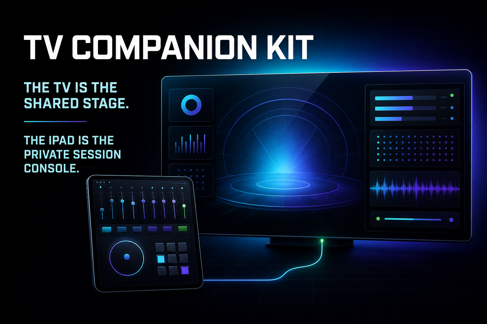
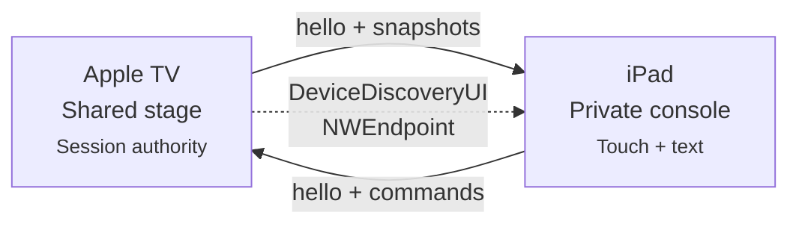

<p align="center">
  
</p>

<h1 align="center">TV Companion Kit</h1>

<p align="center">
  <strong>Build synchronized iPad companion experiences for Apple TV.</strong>
</p>

<p align="center">
  
  
  
  
</p>

<p align="center">
  <a href="https://tv-companion-kit.matthewcassinelli.chatgpt.site"><strong>View the live microsite →</strong></a>
</p>

---

TV Companion Kit is a backend-free SwiftUI sample for pairing an Apple TV
experience with a private iPad session console using
[`DeviceDiscoveryUI`](https://developer.apple.com/documentation/devicediscoveryui)
and [`Network.framework`](https://developer.apple.com/documentation/network).

> **The TV is the shared stage. The iPad is the private session console.**

The iPad is not a mirrored display. Both apps render independently while
exchanging semantic commands and revisioned state over an encrypted local
connection.

## Experience model

| Moment | What happens |
|---|---|
| **1. Pair** | Apple TV presents the system device picker; a nearby iPad approves the local session. |
| **2. Explore privately** | The iPad previews upcoming moments and accepts touch or text input without changing the TV. |
| **3. Send with intent** | Explicit actions such as **Put on TV** and **Share on TV** promote private work to the shared screen. |
| **4. Stay in sync** | Apple TV applies commands and publishes canonical, revisioned snapshots through reconnects. |

The included iPad app provides **Now on TV**, a selectable queue, a private
composer, applause, spotlight, diagnostics, and connection recovery. The TV
experience remains useful before pairing and after the companion leaves.

## Architecture



The transport is deliberately small:

- System-provided, user-approved nearby discovery
- `NWConnection` and `NWListener` using application-service parameters
- Four-byte length-prefixed JSON framing
- Versioned `Codable` envelopes with session and message identifiers
- TV-owned reducer with monotonic state revisions
- Duplicate, stale-session, and stale-callback protection
- Listener recovery and bounded local diagnostics

## Project targets

| Target | Role |
|---|---|
| `TVCompanionTV` | tvOS shared stage, device picker, session host, authoritative reducer |
| `TVCompanionPad` | iPadOS private console, listener, queue, composer, shared controls |
| `TVCompanionKitTests` | Standalone protocol, framing, validation, and reducer tests |

## Quick start

### Requirements

- Xcode 26 or later recommended
- XcodeGen to regenerate the checked-in project
- Physical Apple TV 4K and iPad for pairing
- Both targets signed by the same team with the same universal-purchase bundle identity

### Generate and open

```bash
git clone https://github.com/mattcassinelli/TVCompanionKit.git
cd TVCompanionKit
xcodegen generate
open TVCompanionKit.xcodeproj
```

Select a development team for `TVCompanionPad` and `TVCompanionTV`. If needed,
replace `com.supercomputerstudios.TVCompanionKitDemo` in `project.yml`, keeping
the resulting bundle identifier identical across both platforms.

### Run

1. Launch `TVCompanionPad` on a physical iPad.
2. Launch `TVCompanionTV` on Apple TV 4K.
3. Choose **Connect an iPad** on the TV.
4. Select the iPad and approve the pairing prompt.
5. Explore privately, put a moment on TV, and share a composed message.

DeviceDiscoveryUI pairing does not complete between simulators.

## Tests

```bash
xcodebuild \
  -project TVCompanionKit.xcodeproj \
  -scheme TVCompanionPad \
  -destination 'platform=iOS Simulator,name=iPad Pro 13-inch (M5)' \
  test
```

The 12-test suite covers fragmented and coalesced frames, invalid frame sizes,
reducer boundaries, direct queue selection, message-size validation, invalid
snapshots, and compatibility metadata.

## Repository map

```text
Shared/
  CompanionProtocol.swift    Versioned envelopes, stage state, and commands
  MessageFraming.swift       Length-prefixed JSON framing
  PeerConnection.swift       NWConnection lifecycle and transport
  PresentationReducer.swift  Validated authoritative state changes
iPad/
  PadSessionModel.swift      Listener recovery, negotiation, and state
  PadContentView.swift       Private session-console experience
TV/
  TVSessionModel.swift       Session host and snapshot publisher
  TVContentView.swift        Device picker and shared-stage experience
Tests/
  MessageFramingTests.swift
  PresentationReducerTests.swift
Website/
  app/                       Product microsite
```

## Design notes

The full interaction language, screen states, journey, use cases, and open
questions live in [UX – TV Companion Kit](<UX – TV Companion Kit.md>).

Core rules:

1. **TV first.** The shared experience works without an iPad.
2. **Private by default.** Browsing, typing, and previewing do not change the TV.
3. **Explicit promotion.** Shared actions name their destination.
4. **One source of truth.** Apple TV owns canonical session state.
5. **Graceful distance.** Disconnecting removes enhancements, not the experience.

## What this is not

TV Companion Kit does not register an iPad as an external Apple TV display,
extend a tvOS framebuffer, or provide reverse AirPlay. It demonstrates two
independently rendered apps synchronized through application state.

## Production directions

- Extract the generic envelope, framing, and peer lifecycle into a Swift package.
- Define product-specific payloads above the transport layer.
- Add resume tokens when reconnecting should preserve an existing session.
- Persist trusted-device metadata when continuity across launches matters.
- Add application-layer authentication for security-sensitive commands.
- Introduce a backend only for cross-network sessions, browser clients, room
  codes, unrelated accounts, or multiple simultaneous companions.

## References

- [Apple: Connecting a tvOS app to other devices over the local network](https://developer.apple.com/documentation/devicediscoveryui/connecting-a-tvos-app-to-other-devices-over-the-local-network)
- [Apple: DeviceDiscoveryUI](https://developer.apple.com/documentation/devicediscoveryui)
- [Apple: Network framework](https://developer.apple.com/documentation/network)

---

<p align="center">Built by Supercomputer Studios.</p>
