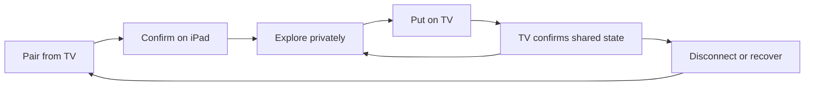

# UX – TV Companion Kit

## Product promise

TV Companion Kit helps an app add a personal, touch-first layer to a shared Apple TV experience without mirroring the TV, requiring a browser, or making the iPad essential to basic playback.

**Experience model:** the TV is the shared stage; the iPad is the private session console.

## Core principles

1. **TV first.** The shared experience remains understandable and operable without an iPad.
2. **Private by default.** Browsing, typing, and previewing on iPad do not change the TV.
3. **Explicit promotion.** Actions that affect the room use clear verbs such as **Put on TV** and **Share on TV**.
4. **One source of truth.** Apple TV owns canonical session state; the companion reflects revisioned snapshots.
5. **Graceful distance.** A dropped connection removes enhanced controls, not the TV experience itself.

## Experience loop

## Screen model

### Apple TV: shared stage

- Strong content hierarchy readable across the room.
- Small, persistent connection status that does not dominate the experience.
- Pairing starts here because the TV establishes the shared context.
- Content sent from iPad is labeled so everyone understands where it came from.
- The TV continues independently when the companion disconnects.

### iPad: session console

- **Now on TV** mirrors semantic state, not pixels.
- **Explore what is next** lets the user inspect a queue privately.
- **Put on TV** makes the boundary between preview and shared action unmistakable.
- **Compose privately** keeps text local until **Share on TV** is chosen.
- Connection and diagnostic information live in the sidebar, away from primary controls.

## Primary journey

1. A person opens the TV experience and chooses **Connect an iPad**.
2. The system device picker finds a nearby iPad running the companion copy.
3. The iPad accepts and becomes a session console.
4. The person browses upcoming moments without changing the TV.
5. They choose **Put on TV** for one moment.
6. Apple TV applies the command and returns a new canonical snapshot.
7. The iPad confirms the selected moment under **Now on TV**.
8. The person drafts a message privately, then chooses **Share on TV**.

## Required states

| State | TV behavior | iPad behavior |
|---|---|---|
| Unpaired | Full standalone experience with Connect action | Advertises availability and explains what pairing adds |
| Connecting | Keeps current content visible | Shows transport and compatibility progress |
| Connected | Displays subtle paired status | Enables shared actions and shows state revision |
| Private exploration | No visual change | Queue and draft remain local |
| Shared update | Applies command and publishes snapshot | Reconciles to the canonical TV state |
| Recovering | Continues standalone | Restarts listener or explains retry |
| Incompatible | Preserves TV session | Explains version mismatch without exposing protocol jargon |

## Interaction language

Prefer verbs that clarify scope:

- **Put on TV** instead of Play or Select
- **Share on TV** instead of Send
- **Clear from TV** instead of Delete
- **Now on TV** instead of Current selection
- **Private draft** instead of Note

## Patterns this can support

- Media browsing, queueing, chapter details, and playback controls
- Party games with public state on TV and private hands on iPad
- Fitness sessions with shared instruction and personal metrics
- Presentations with a shared slide and private notes or controls
- Shopping or travel shows with private research and deliberate shared comparisons
- Accessibility controls and text entry without crowding the TV interface

## Next design questions

- Should reconnecting restore the prior session or always start clean?
- When should the iPad discover the TV versus the TV discovering the iPad?
- Which commands need optimistic UI, and which should always wait for TV confirmation?
- How should multiple people request control when the kit expands beyond one companion?
- What content belongs in a generic package versus the product-specific protocol layer?

## Implementation links

- [Project overview](README.md)
- [Shared protocol](Shared/CompanionProtocol.swift)
- [iPad session console](iPad/PadContentView.swift)
- [TV shared stage](TV/TVContentView.swift)
